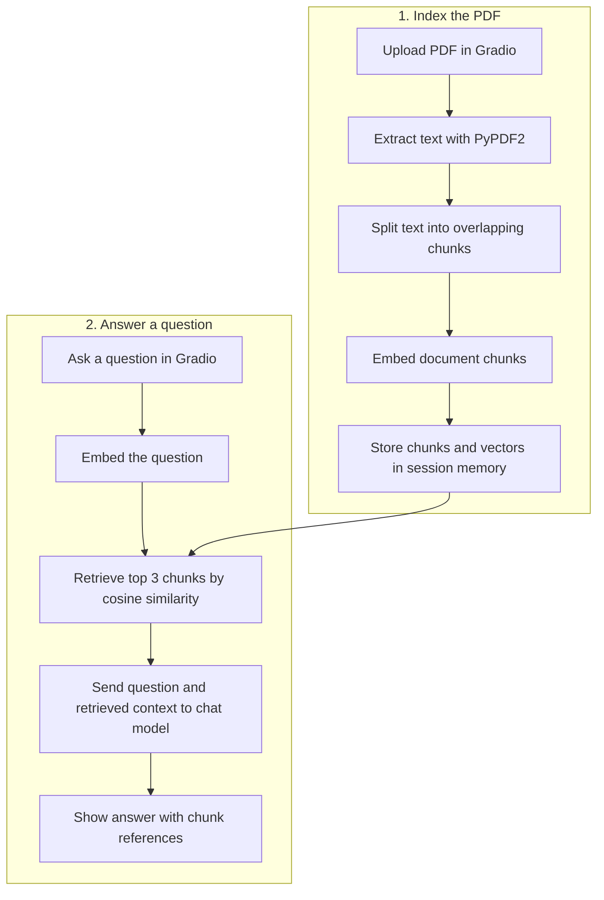
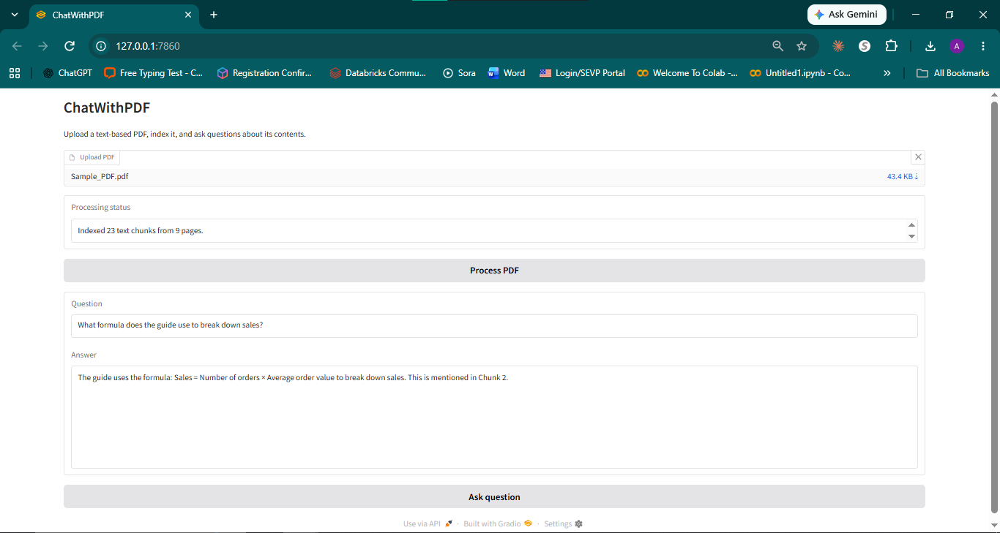
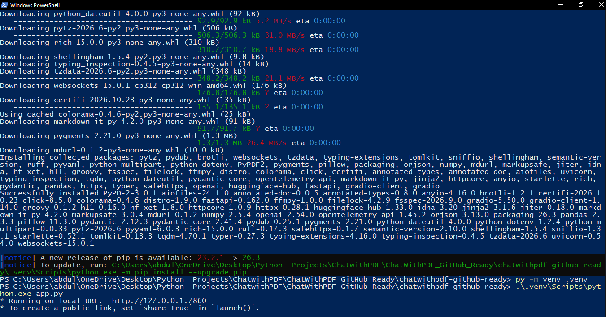

# ChatWithPDF — Generative AI PDF Question Answering

A Python/Gradio application that answers natural-language questions about uploaded, text-based PDFs using retrieval-augmented generation (RAG). This repository includes an updated, simplified implementation (`app.py`) and the original coursework implementation (`original/chatwithpdf_legacy.py`).

## Architecture



The selected backend handles document embeddings, question embeddings, and answer generation.

| Backend | Embeddings | Answer generation |
| --- | --- | --- |
| OpenAI (default) | `text-embedding-3-small` | `gpt-4o-mini` |
| Ollama (local) | `nomic-embed-text` | `qwen2.5:3b` |

**Technologies:** Python, Gradio, PyPDF2, OpenAI API, NumPy. The original prototype used LangChain and FAISS. The current app uses NumPy for in-memory retrieval.

## Setup

The default setup uses OpenAI. For local models without API credits, follow the [Ollama setup guide](docs/ollama.md).

1. Install Python 3.10+ and create a virtual environment.
2. Install dependencies:
   ```bash
   python -m pip install -r requirements.txt
   ```
3. Copy `.env.example` to `.env` and add your own OpenAI API key. Never commit `.env`.
4. Run:
   ```bash
   python app.py
   ```
5. Open the local Gradio URL, upload a text-based PDF, select **Process PDF**, and ask a question.

API usage may incur charges. Use non-sensitive documents that you are permitted to send to an external API.

## Code layout

- `app.py` — simplified, independently runnable Gradio application
- `original/chatwithpdf_legacy.py` — original uploaded LangChain/FAISS prototype, preserved for provenance; it may need older compatible dependencies and is not the default entry point
- `requirements.txt` — install these dependencies to run `app.py`
- [`original/requirements-original-pycharm.txt`](original/requirements-original-pycharm.txt) — reference snapshot of the original PyCharm environment. It includes Streamlit for the separate Lecture Processing Assistant and omits Gradio.
- `.env.example` — API key template, not a real key
- `.gitignore` — excludes secrets, local development files, PDFs and generated indexes

## Current limitations

- Supports selectable-text PDFs; scanned PDFs without a text layer need OCR.
- No measured answer-quality or retrieval benchmark is included.
- Simple character chunking may split passages mid-sentence.
- Chunk references are not page-level citations.
- Very long PDFs may exceed embedding-request input limits.
- The updated implementation uses in-memory vectors, not a persistent vector database; indexed document state lasts only within the user session.
- No deployment, automated test suite, or production security guarantees are claimed.

## Provenance

The original ChatWithPDF prototype was developed in JetBrains PyCharm using Gradio, PyPDF2, LangChain, FAISS, and OpenAI. The `original/` directory preserves the prototype and a snapshot of its PyCharm environment. The current version runs from `app.py` in a standard Python virtual environment.

## Local validation

The current version was tested manually on Windows. The app was launched from PowerShell, then used in a browser to process a Data Analyst Interview Questions and Answers PDF and answer a question about its contents.

**ChatWithPDF demo**



**PowerShell startup**



## Portfolio description

**ChatWithPDF — Retrieval-Augmented PDF Question Answering**: Developed a Python Gradio application for document-grounded question answering, including PDF text extraction, chunking, OpenAI embeddings, similarity-based retrieval, and LLM answer generation.
